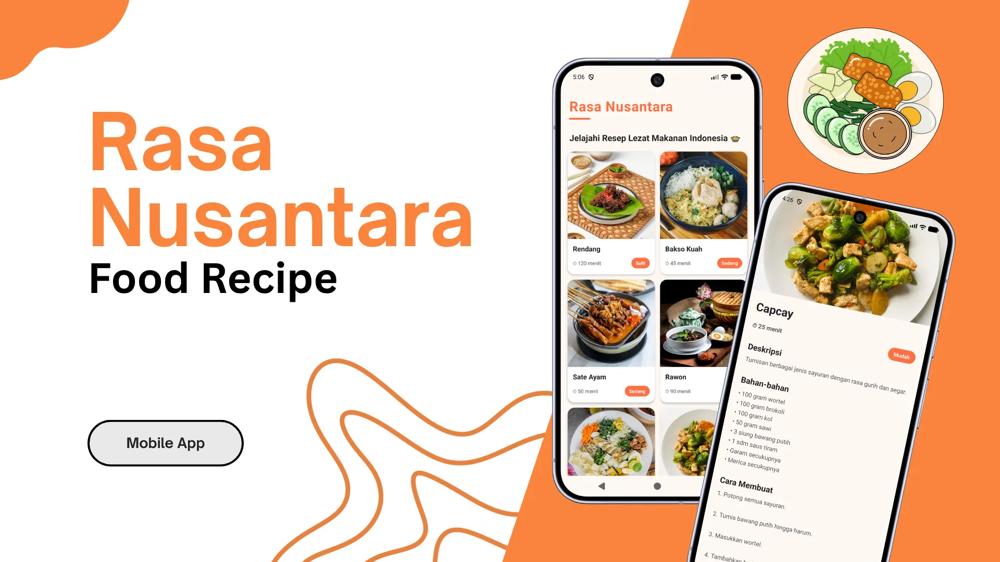
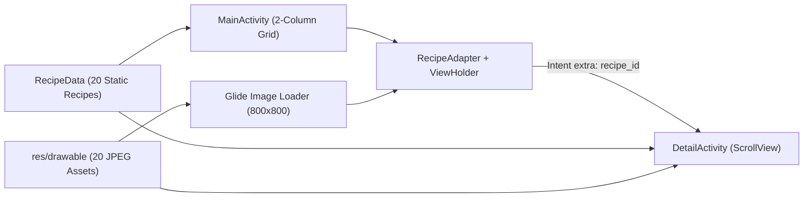
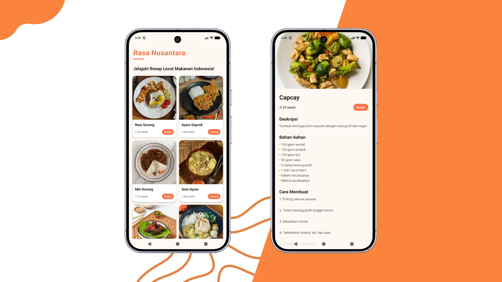

# Rasa Nusantara - Indonesian Food Recipe




## Project Overview

Rasa Nusantara - Indonesian Food Recipe is a native Java Android mobile application designed to present a curated collection of 20 traditional Indonesian dishes in a clean, offline-accessible interface. Built to eliminate the need for active internet connections or account sign-ins while cooking, it allows home cooks and culinary enthusiasts to browse recipes in a two-column visual grid and inspect complete ingredient lists and step-by-step preparation instructions with minimal friction.

## Key Features

- **Offline Curated Recipe Catalog**: Bundles 20 classic Indonesian dishes—including Nasi Goreng, Rendang, Soto Ayam, Rawon, Gado-Gado, and Pempek—with local photography, requiring zero network access.
- **Two-Column Visual Grid Layout**: Displays recipe cards in a responsive two-column `RecyclerView` grid featuring 1:1 square dish thumbnails, titles, cooking duration indicators, and difficulty badges (`Mudah`, `Sedang`, `Sulit`).
- **Memory-Safe Image Downsampling**: Uses Glide to resize and center-crop bundled drawable food images to `800x800` pixels before rendering in grid cards, keeping scrolling smooth and preventing out-of-memory errors.
- **Structured Recipe Detail View**: Opens a dedicated scrollable detail screen via Android `Intent` navigation showing a full-width dish banner, cooking time, difficulty pill, dish description, bulleted ingredients, and numbered cooking steps.
- **Material 3 Warm Culinary Theme**: Applies a custom Material 3 `DayNight.NoActionBar` theme with a warm cream canvas (`#FFF8F3`), coral-orange primary accents (`#FF7043`), and light status/navigation bars.

## Supported Platforms

| Platform | Operating System | Minimum Version | Support / Test Status |
| :--- | :--- | :--- | :--- |
| Android Mobile | Android | Android 8.0 Oreo (API 26) | Configured (`minSdk = 26`, `targetSdk = 37`); local debug APK (`app-debug.apk`) built |

## Tech Stack

| Category | Technology | Purpose |
| :--- | :--- | :--- |
| Programming Language | Java (Java 11 target) | Core application logic, activities, adapter, data model, and static dataset |
| Mobile Framework | Android SDK (`compileSdk = 37`) | Native Android UI lifecycle, `Intent` navigation, and resource management |
| UI & Material Design | AndroidX AppCompat, Material Components (`1.10.0`) | Material 3 theming, `MaterialCardView` recipe cards, and backward-compatible views |
| Layout & Lists | `RecyclerView` (`1.4.0`), `ConstraintLayout` (`2.1.4`) | Two-column `GridLayoutManager` catalog grid and proportional 1:1 card layouts |
| Image Loading | Glide (`4.16.0`) | Safe image decoding, downsampling (`800x800`), and center-cropping for recipe thumbnails |
| Build & Dependency System | Gradle (`9.5.0` Wrapper), Android Gradle Plugin (`9.3.2`) | Kotlin DSL build scripts (`build.gradle.kts`) and Version Catalog (`libs.versions.toml`) |
| Testing Libraries | JUnit 4 (`4.13.2`), AndroidX Test & Espresso (`3.5.1`) | Default unit and instrumented test dependencies configured in Gradle |

## Application Architecture

The application implements a lightweight, self-contained native Android Activity-Adapter-Data architecture without remote APIs or external persistence dependencies. On startup, `MainActivity` retrieves the static `List<Recipe>` from `RecipeData`, binds it to a two-column `RecyclerView` via `RecipeAdapter` (which delegates thumbnail downsampling to Glide), and dispatches click events through an explicit `Intent` carrying `"recipe_id"` to `DetailActivity`, which resolves the matching `Recipe` object and populates the scrollable detail view.



## Screenshots / Preview

### 1. Recipe Catalog Grid & Recipe Detail View



The left mockup displays `MainActivity`, presenting the **Rasa Nusantara** header and a two-column `RecyclerView` grid of recipe cards with square food thumbnails, dish titles, cooking times, and orange difficulty badges. The right mockup shows `DetailActivity` for *Capcay*, combining a full-width header photograph, duration and difficulty indicators, and structured **Deskripsi**, bulleted **Bahan-bahan**, and numbered **Cara Membuat** sections inside a vertical `ScrollView`.

## Prerequisites

- **Java Development Kit (JDK)**: JDK 11 or higher (Gradle daemon toolchain configured for JDK 25 via Foojay resolver; Java 11 source/target compatibility)
- **IDE**: Android Studio (recommended for SDK management and emulator execution)
- **Android SDK**: Android SDK Platform 37 (`compileSdk = 37`) and Android SDK Build-Tools
- **Target Device / Emulator**: Physical Android device or Android Virtual Device (AVD) running Android 8.0 Oreo (API 26) or higher

## Installation & Setup

1. Clone the repository to your local machine:

   ```bash
   git clone https://github.com/weztcy/Rasa-Nusantara-Indonesian-Food-Recipe.git
   cd "Rasa Nusantara - Indonesian Food Recipe"
   ```

2. Verify the local Android SDK path in `local.properties` (or open the project directly in Android Studio so it generates `local.properties` automatically):

   ```properties
   sdk.dir=C:\\Users\\<YourUsername>\\AppData\\Local\\Android\\Sdk
   ```

3. Sync Gradle dependencies and build the debug APK using the Gradle Wrapper:

   ```bash
   ./gradlew assembleDebug
   ```

   On Windows PowerShell or Command Prompt:

   ```powershell
   .\gradlew.bat assembleDebug
   ```

4. Install and run the application on a connected Android device or emulator via Android Studio's **Run** action or `adb`:

   ```bash
   adb install app/build/outputs/apk/debug/app-debug.apk
   ```

## Application Configuration

No runtime environment variables, API keys, or external database connections are required. Build-time and manifest settings are defined directly in `app/build.gradle.kts`, `gradle.properties`, and `app/src/main/AndroidManifest.xml`.

| Configuration | Description | Default / Example |
| :--- | :--- | :--- |
| `applicationId` | Unique Android application package identifier | `com.example.recipe` |
| `minSdk` / `targetSdk` | Minimum supported and target Android API levels | `26` (Android 8.0) / `37` |
| `compileSdk` | Android SDK version used to compile the app | `37` |
| `sourceCompatibility` / `targetCompatibility` | Java language bytecode compatibility level | `JavaVersion.VERSION_11` |
| `org.gradle.jvmargs` | JVM heap and encoding arguments for Gradle builds | `-Xmx2048m -Dfile.encoding=UTF-8` |
| `org.gradle.configuration-cache` | Enables Gradle configuration caching for faster builds | `true` |
| `android:allowBackup` / `android:supportsRtl` | Application backup and RTL layout support in manifest | `true` / `true` |

## Build & Packaging

The project builds standard Android application packages using Gradle Kotlin DSL (`app/build.gradle.kts`) and the Gradle Wrapper (`gradle-9.5.0-bin.zip`).

1. Build an installable debug APK for local testing:

   ```bash
   ./gradlew assembleDebug
   ```

   Output artifact: `app/build/outputs/apk/debug/app-debug.apk` (~21.3 MB).

2. Build a release APK (note that code shrinking/optimization is explicitly disabled in `app/build.gradle.kts` under `buildTypes.release`, and signing configs must be added locally if distributing outside debug builds):

   ```bash
   ./gradlew assembleRelease
   ```

## Usage

After launching **Recipe** (`Rasa Nusantara`) on an Android device or emulator, all 20 recipes are immediately available offline without login or setup.

1. Open the app from the Android launcher to load `MainActivity`.
2. Scroll vertically through the two-column recipe grid to browse available Indonesian dishes along with their estimated cooking times and difficulty tags (`Mudah`, `Sedang`, or `Sulit`).
3. Tap any recipe card to launch `DetailActivity` with the selected dish's `"recipe_id"`.
4. Read the full-width food image, **Deskripsi** summary, bulleted **Bahan-bahan** ingredient list, and numbered **Cara Membuat** preparation steps, then use the Android system Back gesture or button to return to the catalog grid.

## Contributing

Contributions to expand the recipe dataset, improve UI accessibility, or add search and filtering capabilities are welcome.

1. Fork the repository.
2. Create a branch for the change.
3. Make the changes.
4. Validate or test the changes when applicable.
5. Commit and push the branch.
6. Open a pull request with a clear explanation.

## License

This project is licensed under the MIT License.
See the [LICENSE](LICENSE) file for details.

## Author & Contact

**Yohanes Dimas Pratama**

- GitHub: [github.com/weztcy](https://github.com/weztcy)
- Portfolio: [yohanesdimas.com](https://yohanesdimas.com)
- LinkedIn: [linkedin.com/in/yohanes-dimas](https://www.linkedin.com/in/yohanes-dimas)
